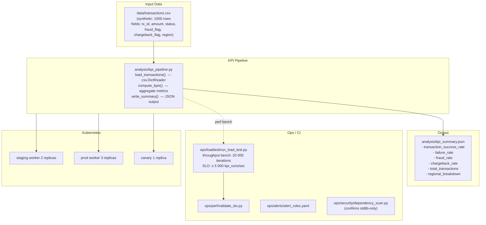
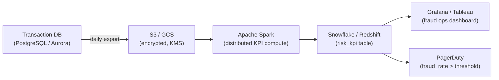

# Architecture — Fintech Risk Ops Analytics

## Overview

The Fintech Risk Ops Analytics platform is a KPI pipeline that reads synthetic transaction data, computes business-critical risk metrics (success rate, fraud rate, chargeback rate, regional breakdown), and writes an aggregated summary. It is designed to run as a scheduled batch job or on-demand analytics worker.

## Component Diagram



## Data Flow

1. **Load** — `load_transactions()` reads `data/transactions.csv` via `csv.DictReader` into a list of dicts
2. **Compute** — `compute_kpis()` calculates:
   - `transaction_success_rate` = succeeded / total
   - `failure_rate` = failed / total
   - `fraud_rate` = fraud_flagged / total
   - `chargeback_rate` = chargeback_flagged / total
   - `regional_breakdown` = per-region counts for all four metrics
3. **Write** — `write_summary()` writes the KPI dict as pretty-printed JSON
4. **SLO gate** — Throughput benchmark ensures `compute_kpis()` sustains ≥ 5 000 runs/sec in CI

## KPI Schema

```json
{
  "transaction_success_rate": 0.8812,
  "failure_rate": 0.1188,
  "fraud_rate": 0.0432,
  "chargeback_rate": 0.0218,
  "total_transactions": 1000,
  "regional_breakdown": {
    "IN": {
      "total": 312,
      "succeeded": 278,
      "failed": 34,
      "fraud": 14,
      "chargebacks": 7
    },
    "US": {
      "total": 688,
      "succeeded": 603,
      "failed": 85,
      "fraud": 29,
      "chargebacks": 15
    }
  }
}
```

## Key Design Decisions

| Decision                  | Rationale                                                                    |
| ------------------------- | ---------------------------------------------------------------------------- |
| CSV input                 | Common format for transaction data exports; easy to swap for a real DB query |
| `defaultdict` for regions | Automatically handles new region codes without schema migration              |
| Stdlib-only               | Zero dependencies — runs in any Python 3.12 environment without pip install  |
| Synthetic data            | No real cardholder data in repo; PCI-DSS compliant by design                 |
| Throughput SLO            | `compute_kpis()` is a hot path — regressions caught before merge             |

## Regulatory Considerations (Production)

| Regulation | Requirement                                       | Status                          |
| ---------- | ------------------------------------------------- | ------------------------------- |
| PCI-DSS    | Tokenise PANs before pipeline entry               | Demo: synthetic data only       |
| SOC 2      | Log all data access with actor + timestamp        | Production integration needed   |
| GDPR/CCPA  | Right-to-erasure for customer-linked transactions | Not applicable (synthetic data) |

## Production Architecture (Target)



## Directory Map

```
fintech-risk-ops-analytics/
├── analysis/
│   ├── kpi_pipeline.py          # load / compute / write
│   ├── run_local_demo.py        # end-to-end demo
│   ├── test_kpi_pipeline.py     # unittest
│   └── kpi_summary.json         # output (gitignored)
├── data/
│   └── transactions.csv         # synthetic transaction data
├── deploy/k8s/
│   ├── staging/ prod/ canary/
├── ops/
│   ├── alerts/ loadtest/ perf/ runbooks/ security/
└── .github/workflows/ci.yml
```
